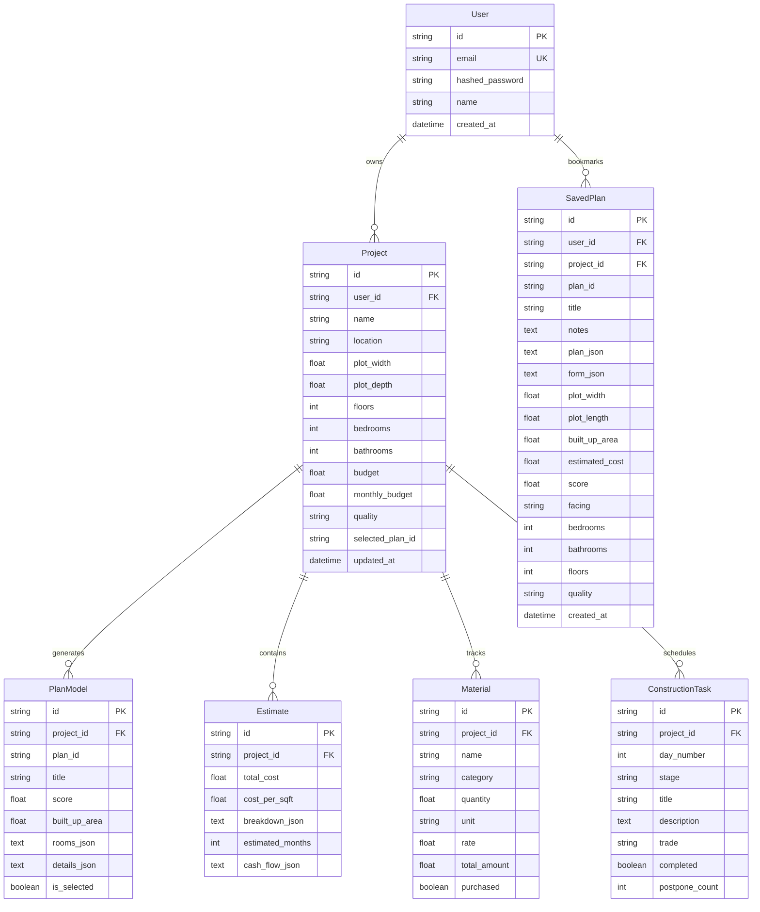

# BuildWise — End-to-End System Functioning & Architectural Specification

> **Project:** BuildWise — Residential House Construction Planning Platform for Tamil Nadu, India  
> **Currency:** Indian Rupee (INR `₹`) | **Units:** Feet (`ft`) & Square Feet (`sq.ft`)  
> **Tech Stack:** React 18 (Vite) + FastAPI (Python 3.13) + SQLite / SQLAlchemy 2.0 + Procedural CAD Geometric Engines + Civil Engineering Simulation Models  
> **Compliance & Standards:** Tamil Nadu Combined Development and Building Rules (TNCDBR 2019), CPWD / TN PWD Schedule of Rates (SOR 2025–2026), Bureau of Indian Standards (IS 456:2000, IS 1200)

---

## Table of Contents
1. [Executive Summary](#1-executive-summary)
2. [End-to-End High-Level Architecture](#2-end-to-end-high-level-architecture)
3. [Frontend System & Page-by-Page Functioning](#3-frontend-system--page-by-page-functioning)
   - [3.1 Global Shell, Routing, & State Synchronization (`App.jsx`)](#31-global-shell-routing--state-synchronization-appjsx)
   - [3.2 Dashboard Page](#32-dashboard-page)
   - [3.3 House Planner Wizard & Saved Plans Portfolio (`HousePlanner.jsx`)](#33-house-planner-wizard--saved-plans-portfolio-houseplannerjsx)
   - [3.4 CAD Floor-Plan Blueprint Engine & Bookmarking (`GeneratedPlan.jsx`)](#34-cad-floor-plan-blueprint-engine--bookmarking-generatedplanjsx)
   - [3.5 Construction Timeline & Dynamic Daily Site Checklist (`Construction.jsx`)](#35-construction-timeline--dynamic-daily-site-checklist-constructionjsx)
   - [3.6 Materials Schedule, Regional Pricing & Wage Standards (`Materials.jsx`)](#36-materials-schedule-regional-pricing--wage-standards-materialsjsx)
   - [3.7 Reports & Bank Loan Sanction Dossier (`Reports.jsx`)](#37-reports--bank-loan-sanction-dossier-reportsjsx)
   - [3.8 Authentication & User Management Modal (`AuthModal.jsx`)](#38-authentication--user-management-modal-authmodaljsx)
4. [Backend Architecture & API Endpoints Directory](#4-backend-architecture--api-endpoints-directory)
5. [Computational Models & Domain Engines in Detail](#5-computational-models--domain-engines-in-detail)
   - [5.1 Procedural Floor-Plan Solver & CAD Geometry Engine](#51-procedural-floor-plan-solver--cad-geometry-engine)
   - [5.2 Civil Engineering Cost Estimation Model](#52-civil-engineering-cost-estimation-model)
   - [5.3 Discrete-Event Construction Schedule Simulator](#53-discrete-event-construction-schedule-simulator)
   - [5.4 Dynamic Daily Site Task & Physical Verification Engine](#54-dynamic-daily-site-task--physical-verification-engine)
   - [5.5 TNCDBR 2019 Statutory Building Compliance Engine](#55-tncdbr-2019-statutory-building-compliance-engine)
   - [5.6 Pre-Construction Ancillary Infrastructure Model](#56-pre-construction-ancillary-infrastructure-model)
   - [5.7 Milestone Escrow & Quality Checkpoint Model](#57-milestone-escrow--quality-checkpoint-model)
   - [5.8 Materials Bill of Quantities (BOQ) & Regional Rate Engine](#58-materials-bill-of-quantities-boq--regional-rate-engine)
   - [5.9 Machine Learning Audit & Civil Engineering Honesty Disclosure](#59-machine-learning-audit--civil-engineering-honesty-disclosure)
6. [Database Schema & Entity Relationship Model](#6-database-schema--entity-relationship-model)
7. [End-to-End Operational Walkthrough (User Journey)](#7-end-to-end-operational-walkthrough-user-journey)
8. [Testing, Verification, & Quality Assurance](#8-testing-verification--quality-assurance)

---

## 1. Executive Summary

**BuildWise** is an integrated civil engineering and architectural planning application tailored for individuals, contractors, and architects constructing independent residential houses across the 38 districts of Tamil Nadu.

Traditional home construction planning tools either rely on generic international metrics (square meters, USD) or over-simplify construction into rough per-square-foot ballpark figures, completely omitting local municipal setbacks, regional soil conditions, pre-construction utilities (borewell, sump, TNEB power), daily trade wages, and bank loan disbursement milestones.

BuildWise bridges this gap by combining:
- A responsive, accessible React user interface that retains pristine visual design across light and dark themes.
- A pure-Python FastAPI microservices backend powered by SQLite/SQLAlchemy 2.0.
- An algorithmic, multi-archetype floor-plan solver that adheres strictly to Tamil Nadu Combined Development and Building Rules (TNCDBR 2019).
- AutoCAD-grade 2D vector blueprint graphics featuring double-line load-bearing structural walls, curved door swings, ventilation fenestrations, and authentic fixtures.
- Dynamic day-to-day construction scheduling providing an editable, physical task checklist for all working days of construction.
- Real-world Tamil Nadu PWD Schedule of Rates (SOR 2025–2026) and Builders Association of India (BAI) market data.
- Formal Bank Loan Sanction Dossiers tailored for SBI Realty and HDFC Home Loans with an 80% Loan-to-Value (LTV) framework.

---

## 2. End-to-End High-Level Architecture

```
┌──────────────────────────────────────────────────────────────────────────────────────────────────┐
│                                   REACT VITE FRONTEND (PORT 5173)                                │
│                                                                                                  │
│   ┌─────────────────┐  ┌────────────────────┐  ┌──────────────────┐  ┌─────────────────────────┐ │
│   │  App.jsx Shell  │  │  HousePlanner.jsx  │  │ GeneratedPlan.jsx│  │    Construction.jsx     │ │
│   │  (Sync & Auth)  │  │  (4-Step & Saved)  │  │ (CAD Blueprint)  │  │ (Dynamic Daily Tasks)   │ │
│   └────────┬────────┘  └─────────┬──────────┘  └────────┬─────────┘  └────────────┬────────────┘ │
│            │                     │                      │                         │              │
│            │           ┌─────────┴──────────┐  ┌────────┴─────────┐               │              │
│            │           │   Materials.jsx    │  │   Reports.jsx    │               │              │
│            │           │ (Districts & Wages)│  │ (Bank Loan Doss.)│               │              │
│            │           └─────────┬──────────┘  └────────┬─────────┘               │              │
│            │                     │                      │                         │              │
│            └─────────────────────┴──────────┬───────────┴─────────────────────────┘              │
│                                             │  HTTP (REST + JWT Bearer)                          │
│                                             │  Custom Event Bus (buildwise:project-updated)      │
└─────────────────────────────────────────────┼────────────────────────────────────────────────────┘
                                              ▼
┌──────────────────────────────────────────────────────────────────────────────────────────────────┐
│                                  FASTAPI PYTHON BACKEND (PORT 8000)                              │
│                                                                                                  │
│   ┌──────────────────────────────────────────────────────────────────────────────────────────┐   │
│   │                                   API ROUTERS LAYER                                      │   │
│   │  /api/auth       /api/generate      /api/estimate      /api/projects      /api/ml        │   │
│   └─────────────────────────────────────────┬────────────────────────────────────────────────┘   │
│                                             │                                                    │
│   ┌─────────────────────────────────────────┴────────────────────────────────────────────────┐   │
│   │                               COMPUTATIONAL DOMAIN ENGINES                               │   │
│   │  ┌───────────────────────┐ ┌───────────────────────┐ ┌────────────────────────────────┐  │   │
│   │  │ FloorPlanSolver       │ │ CostEngine (CPWD/SOR) │ │ ScheduleSimulator (Cash Flow)  │  │   │
│   │  │ (4 Archetypes / Vastu)│ │ (100% Rounding Sum)   │ │ (Predecessors & Monsoon Delay) │  │   │
│   │  └───────────────────────┘ └───────────────────────┘ └────────────────────────────────┘  │   │
│   │  ┌───────────────────────┐ ┌───────────────────────┐ ┌────────────────────────────────┐  │   │
│   │  │ DailyTasksEngine      │ │ ComplianceEngine      │ │ AncillaryCostModel             │  │   │
│   │  │ (Dynamic Days 1..N)   │ │ (TNCDBR Rule 35 & RWH)│ │ (Borewell, Sump, EB, Sanction) │  │   │
│   │  └───────────────────────┘ └───────────────────────┘ └────────────────────────────────┘  │   │
│   │  ┌───────────────────────┐ ┌───────────────────────┐ ┌────────────────────────────────┐  │   │
│   │  │ MilestoneEscrowModel  │ │ MaterialsBOQEngine    │ │ ML Transparency Status         │  │   │
│   │  │ (8 Stages / Retention)│ │ (TN District Index)   │ │ (Formula Honesty Audit)        │  │   │
│   │  └───────────────────────┘ └───────────────────────┘ └────────────────────────────────┘  │   │
│   └─────────────────────────────────────────┬────────────────────────────────────────────────┘   │
│                                             │ SQLAlchemy 2.0 ORM                                 │
│                                             ▼                                                    │
│   ┌──────────────────────────────────────────────────────────────────────────────────────────┐   │
│   │                              SQLITE PERSISTENCE (buildwise.db)                           │   │
│   │   [users]   [projects]   [plans]   [estimates]   [materials]   [tasks]   [saved_plans]   │   │
│   └──────────────────────────────────────────────────────────────────────────────────────────┘   │
└──────────────────────────────────────────────────────────────────────────────────────────────────┘
```

---

## 3. Frontend System & Page-by-Page Functioning

The frontend is built with React 18, utilizing functional components, custom hooks, Lucide React icons, and modern CSS variables (`var(--surface)`, `var(--text)`, `var(--accent)`, `var(--border)`). The entire application runs without third-party router libraries, implementing clean state-driven tab switching.

### 3.1 Global Shell, Routing, & State Synchronization (`App.jsx`)
- **State Navigation:** `activePage` controls which view is active: `Dashboard`, `House Planner`, `Construction`, `Materials`, or `Reports`. When a plan is actively generated, `showGeneratedPlan` switches to `GeneratedPlan.jsx` as a full-page overlay.
- **Theme Provider:** Connects to `ThemeContext.jsx` enabling instant toggle between high-contrast Dark theme and daylight Light theme.
- **Reactive Event Bus:** Listens to `window.addEventListener("buildwise:project-updated")`. When a user generates, selects, or modifies a house plan on any page, a global version increment (`projectVersion`) is triggered. All sibling tabs reactively reload their data from the backend without requiring a browser reload.
- **Authentication State:** Checks `/api/auth/me` on startup. If a valid JWT token exists in `localStorage`, the user is authenticated, and their profile circle shows their initials (e.g. `N` for Narmathan). If unauthenticated, a clear "Sign In" button is displayed.

### 3.2 Dashboard Page
The Dashboard serves as the central command cockpit for the active residential project.
- **Project Summary Header:** Reads live from `GET /api/projects/current/summary`. Displays the project name, district location (e.g., "Coimbatore, Tamil Nadu"), plot area ($2,400\,\text{sq ft}$), built-up area ($1,850\,\text{sq ft}$), budget utilization status, and total timeline duration in months.
- **Empty State Handler:** If no project is seeded or planned, displays an inviting empty state card prompting the homeowner to start planning.
- **5-Step Master Progress Stepper:** Visually displays the macro-phases of homebuilding: Planning $\rightarrow$ Foundation $\rightarrow$ Structure $\rightarrow$ Finishing $\rightarrow$ Complete.
- **Quick Links:** Direct one-click access into the House Planner, Construction tracker, and Material schedule.

### 3.3 House Planner Wizard & Saved Plans Portfolio (`HousePlanner.jsx`)
A 4-step wizard with live validation and boundary enforcement:
- **Step 1: Plot Dimensions & Orientation:**
  - Length and width inputs (range: $20\,\text{ft}$ to $200\,\text{ft}$).
  - Automatically calculates total plot area ($Length \times Width\,\text{sq ft}$).
  - Road Facing orientation selector: North, East, South, West (critical for Vastu Shastra orientation).
  - Location selector defaulting to Tamil Nadu with district-level cost mapping.
  - Interactive Step 1 plot boundary SVG preview.
  - **Saved Plans Shortcut Banner:** Displays the count of saved blueprints in the user's portfolio and allows opening the portfolio modal with a single click.
- **Step 2: Spatial Requirements:**
  - Bedrooms (1 to 8) and Bathrooms (1 to 6).
  - Number of Floors (1 to 4).
  - Specific architectural amenities: Covered Car Parking Porch, Covered Balcony / Verandah Sit-Out (`பூமுக வராண்டா`), Pooja Room, and Attached Utility / Wash Yard.
- **Step 3: Budget & Affordability:**
  - Total construction budget input (INR `₹`, formatted with Indian comma separators: Lakhs and Crores).
  - Quality tier selection: Economy (₹1,800/sq ft), Standard (₹2,200/sq ft), Premium (₹2,800/sq ft).
  - Planned monthly construction cash flow budget.
  - **Live Server-Side Affordability Indicator:** Evaluates projected monthly cash burn against the user's monthly budget by calling `/api/estimate/affordability`, replacing hardcoded mock metrics with dynamic risk feedback ("Good", "Tight", "Insufficient").
- **Step 4: Review & Auth-Gated Generation:**
  - Summarizes dimensional, spatial, and financial parameters.
  - **Authentication Gate:** If the user is unauthenticated, clicking "Generate house plan" automatically opens `AuthModal` with a clear message: *"Sign in or create an account to generate and save your architectural floor plan."* Upon successful login (or clicking Quick Demo Sign In), the pending plan generation immediately proceeds without requiring re-entry.
- **Saved Plans & Blueprints Portfolio Modal:**
  - Accessible via the "Saved Plans (N)" button in the header or the Step 1 banner.
  - Displays all previously bookmarked blueprints with plot dimensions, facing, BHK count, bathroom count, built-up area ($\text{sq ft}$), estimated civil cost in Lakhs, TNCDBR 2019 compliance badge, and custom client notes.
  - **Load into Planner:** Injects the saved plan's exact inputs back into the 4-step wizard, displaying a green confirmation banner so the user can inspect or refine specifications.
  - **Open Blueprint:** Directly navigates into `GeneratedPlan.jsx` displaying the saved CAD layout without re-running generation.
  - **Delete:** Removes the plan from the saved portfolio.

### 3.4 CAD Floor-Plan Blueprint Engine & Bookmarking (`GeneratedPlan.jsx`)
Renders the generated house plan using professional architectural vector CAD graphics:
- **AutoCAD-Grade Visual Elements:**
  - **Double-Line Structural Walls:** $9''$ exterior load-bearing walls and $4.5''$ interior partition walls rendered with high-contrast structural borders.
  - **Curved Door Swings:** Authentic $90^\circ$ circular arc trajectories indicating door clearance and inward room accessibility.
  - **Exterior Fenestrations (Windows):** Glazed window symbols with blue highlight panes along perimeter exterior walls ensuring ventilation compliance.
  - **Tamil Nadu Residential Fixtures:** Precision SVG outlines for king/queen beds with pillows and side tables, western commodes with cistern tanks, washbasins, L-shaped modular kitchen slabs with 3-burner gas stoves and sinks, 6-seater dining sets, living room sectional sofas, car parking vehicle silhouette, and verandah sit-out deck planking.
- **100% Room Preservation:**
  - Guarantees that every requested bedroom, bathroom (1 to 6), kitchen, dining hall, pooja room, utility yard, parking porch, and covered verandah is drawn without omissions.
  - Kitchens are realistically dimensioned ($140\text{--}258\,\text{sq ft}$) rather than cramped leftover strips.
- **Rotational Multi-Archetype Generation ("Another plan"):**
  - Clicking "Another plan" increments the seed and generates distinct architectural layouts:
    - *Archetype 0: Traditional Vastu Courtyard Flow* (NW Car Porch, NE Verandah/Living, Brahmasthan Dining, SE Agni Kitchen/Utility, SW Niruthi Master Suite).
    - *Archetype 1: Contemporary Open Great-Room Layout* (L-shaped social pavilion, open dining, island kitchen with pantry, side sleeping suites).
    - *Archetype 2: Split-Wing Generational Suite Layout* (Step-free senior bedroom with private bath at front left, central family living & dining, rear master suite).
    - *Archetype 3: Linear Breezeway & Central Gallery Suite Layout* (H-plan with central gallery corridor dividing private suites and daytime pavilion).
- **Comparison Mode:** Allows side-by-side thumbnail comparison of alternative candidate layouts.
- **Save Liked Plans Bookmarking:**
  - Dedicated "Save Plan to Liked" button in the intro bar and plan card header.
  - Opens the "Save Plan to Liked Portfolio" modal allowing users to enter a custom layout title and personal client notes (e.g., *"DTCP single-window approval copy. Client requested pooja altar in northeast corner."*).
  - Saved plans are badged with a gold star (`★`) on layout chips and display a `"✓ Saved to Liked Plans"` state.
  - Displays a floating green confirmation toast upon saving.

### 3.5 Construction Timeline & Dynamic Daily Site Checklist (`Construction.jsx`)
- **Discrete Stage Progression:** Tracks progress across 7 sequential construction stages (Site Preparation, Foundation, Structure & Slabs, Walls & Partitions, Electrical & Plumbing, Flooring & Plastering, Finishing & Handover).
- **Cost-Weighted Overall Progress:** Unlike naive stage averaging, overall project progress is weighted by actual financial expenditure per stage, accurately reflecting true capital commitments.
- **Dynamic Day-to-Day Timeline (Days 1 to $N$):**
  - Dynamically calculates total working days based on the active project schedule ($months \times 25$ days, e.g., Day 1 to Day 350 for a 14-month schedule).
  - Displays individual day cards with assigned trade specialists (Head Mason, Barbender, Plumber, Electrician, Shuttering Carpenter).
- **Unchecked Daily Checklist (`completed: false`):**
  - All tasks initialize unchecked, empowering the homeowner to physically verify and check off daily work on-site.
- **Full Manual Task Editing & Management:**
  - **Edit Task Modal:** Allows updating title, description, trade specialist, assigned day number, and construction stage.
  - **Postpone Task (+1 Day):** Shifts delayed work to the next construction day with an incrementing postponement counter.
  - **Add Custom Task:** Enables adding site-specific tasks for any construction day.
  - **Delete Task:** Removes obsolete tasks.
  - **Re-sync Plan:** Re-aligns checklist tasks with active plan duration.
- **On-Site Quality Check Inspection List:**
  - Highlights essential structural verification checks: 50mm RCC cover blocks, 14-day continuous wet hessian curing, field sand silt jar test ($<8\%$), CPVC 10-bar water pressure test, and vitrified floor tile mallet tap test.
- **8-Stage Contractor Payment Escrow Schedule:**
  - Clear milestone disbursement breakdown tied to physical progress, including a mandatory 5% defect liability retention fund held for 90 days post-handover.

### 3.6 Materials Schedule, Regional Pricing & Wage Standards (`Materials.jsx`)
- **Bill of Quantities (BOQ):** Computes exact physical quantities for core building materials (Cement bags, Steel tons, M-Sand tons, Country Bricks, Floor Tiles, Paint litres, Teakwood, Plumbing lines) using civil engineering thumb rules and active built-up area.
- **Numeric Quantities & Procurement Toggle:** Homeowners can toggle purchase status (`purchased: true/false`), instantly updating total spent vs remaining material budgets.
- **5-Zone Tamil Nadu District Pricing Switcher:**
  - Chennai (CMDA Metro, 1.08x)
  - Coimbatore (Kongu Baseline, 1.00x)
  - Madurai (South Hub, 0.96x)
  - Tiruchirappalli (Delta Hub, 0.95x)
  - Salem (Steel & Mineral Hub, 0.94x)
- **Daily Wage Schedule Modal:** Displays official Tamil Nadu PWD Schedule of Rates 2025–2026 daily wage standards across all 7 construction trades (Head Mason: ₹1,150/day, Assistant Mason: ₹900/day, Barbender: ₹950/day, Shuttering Carpenter: ₹950/day, Plumber: ₹900/day, Electrician: ₹900/day, Helper: ₹650/day).
- **Custom Materials & Data Export:** Add custom site materials, delete custom materials, and download the complete materials provenance dataset as a standard CSV file (`/api/projects/current/materials/dataset/csv`).

### 3.7 Reports & Bank Loan Sanction Dossier (`Reports.jsx`)
- **Consolidated 3-Tier Capital Structure:**
  1. *Civil Construction Contract:* Superstructure, masonry, joinery, and architectural finishes.
  2. *Pre-Construction Ancillary Packages:* Itemized site infrastructure expenses.
  3. *All-Inclusive Total Project Capital:* True financial commitment required to complete the home.
- **Institutional Bank Loan Project Dossier (SBI / HDFC):**
  - Computes maximum 80% Loan-to-Value (LTV) bank loan eligibility and mandatory 20% homeowner equity contribution.
  - Stage-by-stage bank technical valuer disbursement schedule aligned with physical inspection milestones.
- **TNCDBR 2019 Statutory Compliance Certificate:** Formal verification of ground coverage ($\le 70\%$), Floor Space Index (FSI), setback compliance, and Rainwater Harvesting (RWH) recharge pit sizing.
- **Printable Output:** Integrated `window.print()` formatting optimized for clean PDF generation and DTCP / bank officer review.

### 3.8 Authentication & User Management Modal (`AuthModal.jsx`)
- **Secure Authentication:** Tabbed modal supporting user login and registration.
- **Quick Demo Sign In:** One-click demo builder access (`guest@buildwise.local`), automatically seeding sample projects and saved blueprints.
- **Auto-Resumption:** Contextual notice when triggered from the planner, automatically continuing plan generation upon sign-in.

---

## 4. Backend Architecture & API Endpoints Directory

The backend is built with FastAPI (Python 3.13), utilizing asynchronous request handling, Pydantic validation models, and SQLAlchemy 2.0 ORM over SQLite.

### Complete RESTful API Endpoints Directory

| Category | HTTP Method | Endpoint | Description |
|---|---|---|---|
| **Health & Meta** | `GET` | `/api/health` | Health check endpoint returning timestamp and service status |
| | `GET` | `/api/ml/status` | Engineering honesty disclosure on formula vs ML status |
| **Authentication** | `POST` | `/api/auth/register` | Register a new user with bcrypt-hashed credentials |
| | `POST` | `/api/auth/login` | Authenticate user and issue signed JWT bearer token |
| | `GET` | `/api/auth/me` | Fetch active user profile and authenticated status |
| **Floor-Plan Engine**| `POST` | `/api/generate` | Algorithmic floor-plan generation matching geometric setbacks |
| **Saved Plans** | `GET` | `/api/plans/saved` | Retrieve all saved plans and liked blueprints for user |
| | `POST` | `/api/plans/saved` | Bookmark/save a liked floor plan with custom title & notes |
| | `GET` | `/api/plans/saved/{id}`| Retrieve specific saved blueprint by record ID or `plan_id` |
| | `PUT` | `/api/plans/saved/{id}`| Update title or client notes on a saved blueprint |
| | `DELETE`| `/api/plans/saved/{id}`| Remove a blueprint from the saved portfolio |
| **Estimates** | `POST` | `/api/estimate/affordability` | Live affordability risk evaluator for Planner Step 3 |
| | `POST` | `/api/estimate/cost` | Comprehensive civil cost breakdown by quality & district |
| | `POST` | `/api/estimate/schedule`| Month-by-month cash flow and timeline simulation |
| | `POST` | `/api/estimate/compliance`| Evaluate plot parameters against TNCDBR 2019 Rule 35 |
| | `POST` | `/api/estimate/ancillary` | Calculate itemized pre-construction ancillary packages |
| **Projects** | `GET` | `/api/projects/current` | Retrieve active project with layout and estimate data |
| | `PUT` | `/api/projects/current` | Update project requirements and candidate plans |
| | `PUT` | `/api/projects/current/selected-plan`| Set active plan layout and re-sync dependent estimates |
| | `GET` | `/api/projects/current/summary` | Dashboard summary metrics and master timeline status |
| | `GET` | `/api/projects/current/construction?month=n` | Stage progress and site insights for month `n` |
| | `GET` | `/api/projects/current/milestones` | 8-stage contractor payment escrow and retention fund |
| | `GET` | `/api/projects/current/compliance` | TNCDBR 2019 compliance check for active project |
| | `GET` | `/api/projects/current/ancillary` | Pre-construction ancillary expenses for active project |
| | `GET` | `/api/projects/current/report` | Complete Bank Loan & DTCP Project Dossier |
| **Materials** | `GET` | `/api/projects/current/materials` | Materials schedule, categories, and purchase stats |
| | `GET` | `/api/projects/current/materials/districts` | 5-zone district price multipliers & PWD labor wages |
| | `GET` | `/api/projects/current/materials/dataset` | Official Tamil Nadu PWD SOR & BAI provenance dataset |
| | `GET` | `/api/projects/current/materials/dataset/csv` | Download materials provenance dataset as CSV file |
| | `PATCH`| `/api/projects/current/materials/{id}`| Toggle purchase status or edit quantity/rate |
| | `POST` | `/api/projects/current/materials` | Add custom material to the project schedule |
| | `DELETE`| `/api/projects/current/materials/{id}`| Delete custom material from schedule |
| **Daily Tasks** | `GET` | `/api/projects/current/tasks` | Dynamic daily site checklist (Days 1 to $N$) |
| | `PATCH`| `/api/projects/current/tasks/{id}`| Toggle daily site task complete / incomplete |
| | `PUT` | `/api/projects/current/tasks/{id}`| Manually edit task (title, description, trade, day, stage)|
| | `DELETE`| `/api/projects/current/tasks/{id}`| Delete construction site task |
| | `POST` | `/api/projects/current/tasks/{id}/postpone` | Postpone task to the next construction day (+1 Day) |
| | `POST` | `/api/projects/current/tasks` | Create custom site task for any construction day |
| | `POST` | `/api/projects/current/tasks/regenerate` | Re-sync checklist tasks with active plan schedule |

---

## 5. Computational Models & Domain Engines in Detail

### 5.1 Procedural Floor-Plan Solver & CAD Geometry Engine
- **File:** `backend/app/services/floorplan/solver.py`
- **Methodology:** Procedural constraint-satisfaction engine and geometric space decomposition.
- **Setback Envelopes:**
  $$\text{Front Setback} = 5.0\,\text{ft},\quad \text{Rear Setback} = 3.0\,\text{ft},\quad \text{Side Setbacks} = 3.0\,\text{ft}$$
  $$\text{Buildable Width} = \text{Plot Width} - (\text{Left} + \text{Right}),\quad \text{Buildable Depth} = \text{Plot Depth} - (\text{Front} + \text{Rear})$$
- **Architectural Archetypes:**
  - **Archetype 0: Traditional Vastu Courtyard Flow:**
    - Car Porch in North-West (Vayu sthana).
    - Living Room & Entrance Verandah in North-East (Ishanya sthana).
    - Dining Hall in Central Core (Brahmasthan).
    - Kitchen & Utility in South-East (Agni sthana).
    - Master Bedroom Suite with Attached Bath in South-West (Niruthi sthana).
  - **Archetype 1: Contemporary Open Great-Room Layout:**
    - Expansive open-plan living, dining, and modular kitchen lounge.
    - Side-wing sleeping suites with sound isolation corridors.
  - **Archetype 2: Split-Wing Generational Suite Layout:**
    - Step-free senior suite with private attached bath in the front wing.
    - Private master suite at the rear wing for maximum acoustic privacy.
  - **Archetype 3: Linear Breezeway & Central Gallery Suite Layout:**
    - Central cross-ventilated gallery corridor maximizing continuous natural ventilation.
- **Room Preservation Guarantee:**
  - Every requested bedroom ($1\text{--}8$), bathroom ($1\text{--}6$), kitchen ($140\text{--}258\,\text{sq ft}$), dining room, pooja room, utility yard, parking porch, and balcony/sit-out is allocated an explicit rectangular or polygonal CAD bounding box with structural walls, doors, windows, and furnishings.

### 5.2 Civil Engineering Cost Estimation Model
- **File:** `backend/app/services/cost.py`
- **Rate Cards (CPWD Plinth Area Rates & TN PWD SOR 2025–2026):**
  - **Economy:** ₹1,800 per sq ft built-up area (M20 concrete, country clay brick masonry, vitrified tiles ₹55/sq ft, semi-solid flush doors, acrylic distemper).
  - **Standard:** ₹2,200 per sq ft built-up area (M20/M25 concrete, fly ash/wire-cut bricks, vitrified tiles ₹85/sq ft, teakwood main door frame, premium emulsion).
  - **Premium:** ₹2,800 per sq ft built-up area (M25 design mix, Italian marble / premium vitrified ₹160/sq ft, full first-class teak joinery, UPVC double-glazed windows, luxury Royale emulsion).
- **Location Cost Multiplier:** Applied dynamically based on district logistics, quarry proximity, and river sand lead distance (Chennai: 1.08x, Coimbatore: 1.00x, Madurai: 0.96x, Tiruchirappalli: 0.95x, Salem: 0.94x).
- **Exact 100% Breakdown Sum (Largest-Remainder Method):**
  The five structural cost categories are divided into standard civil engineering proportions:
  $$\text{Structure (45\%)}, \text{Masonry (18\%)}, \text{Electrical \& Plumbing (15\%)}, \text{Flooring \& Finishing (12\%)}, \text{Doors \& Windows (10\%)}$$
  To prevent rounding errors where rounded category percentages sum to 98% or 101%, the engine utilizes the Hare-Niemeyer largest-remainder algorithm, guaranteeing that individual line items sum to exactly 100.0% of the total cost.

### 5.3 Discrete-Event Construction Schedule Simulator
- **File:** `backend/app/services/schedule.py`
- **Methodology:** Discrete-event simulation across 7 sequential stages governed by a Directed Acyclic Graph (DAG) of predecessor dependencies:
  $$\text{Site Prep} \rightarrow \text{Foundation} \rightarrow \text{Structure} \rightarrow \text{Walls} \rightarrow \text{Plumbing \& Electrical} \rightarrow \text{Finishing} \rightarrow \text{Handover}$$
- **Capital Burn Capacity Constraint:** Physical monthly execution capacity is capped at ₹5,00,000 to prevent unrealistic schedules where ₹35 Lakhs is claimed to be executable in 2 months.
- **Monsoon Slowdown Adjustment:** Construction months intersecting the North-East Monsoon in Tamil Nadu (October, November, December) automatically receive a 1.25x timeline penalty for outdoor earthwork and roof slab concreting.

### 5.4 Dynamic Daily Site Task & Physical Verification Engine
- **Files:** `backend/app/services/daily_tasks.py`, `backend/app/routers/tasks.py`
- **Dynamic Days Calculation:**
  $$\text{Total Working Days} = \text{Estimated Months} \times 25\,\text{working days/month}$$
  For example, a 14-month schedule generates 350 discrete construction working days.
- **Task Allocation:** Each working day is allocated specific technical trade tasks (e.g. Day 1: Site benchmark layout, Day 28: Plinth beam shuttering, Day 85: Roof slab reinforcement tying, Day 170: CPVC concealed rough-in).
- **Interactive State Operations:** Supports complete CRUD, checkbox toggles, manual task editing, and single-click day postponement (+1 Day) with ripple schedule shifts.

### 5.5 TNCDBR 2019 Statutory Building Compliance Engine
- **File:** `backend/app/services/compliance.py`
- **Rule 35 Standards Evaluated:**
  - **Ground Coverage:** Must not exceed 70.0% of total plot area:
    $$\text{Ground Coverage \%} = \left(\frac{\text{Ground Floor Built-up Area}}{\text{Plot Area}}\right) \times 100 \le 70.0\%$$
  - **Floor Space Index (FSI):** Evaluated against standard non-high-rise residential limit ($\le 1.5$ or $2.0$ depending on road width).
  - **Setbacks:** Front setback $\ge 1.5\,\text{m}$ ($5\,\text{ft}$), Rear setback $\ge 1.0\,\text{m}$ ($3\,\text{ft}$), Side setbacks $\ge 1.0\,\text{m}$ ($3\,\text{ft}$).
  - **Rainwater Harvesting (RWH):** Section 215-A of Tamil Nadu District Municipalities Act requires a minimum percolation pit storage capacity of 40 litres per square meter of roof catchment area.

### 5.6 Pre-Construction Ancillary Infrastructure Model
- **File:** `backend/app/services/ancillary.py`
- Itemizes mandatory infrastructure costs:
  1. DTCP / CMDA Single-Window Plan Sanction & Scrutiny Fee.
  2. TANGEDCO (TNEB) 3-Phase Domestic Service Connection & Meter Security Deposit.
  3. 300-ft Deep Borewell Drilling, PVC Casing, and 1.5 HP Stainless Steel Submersible Pump.
  4. 8,000-Litre Underground RCC Water Sump & Bio-Septic Tank with Soak Pit.
  5. 140 R.ft Compound Wall with RCC Stiffeners & 12-ft Wrought Iron Gate.
  6. Soil Investigation (Standard Penetration Test) & Structural Engineering Stamped Drawings.
  7. Rainwater Harvesting Percolation Recharge Shaft with Filter Bed.

### 5.7 Milestone Escrow & Quality Checkpoint Model
- **File:** `backend/app/services/milestones.py`
- **8-Stage Milestone Payment Schedule:**
  - Stage 1: Mobilization & Site Layout (5%)
  - Stage 2: Footings & Plinth Beam Casting (15%)
  - Stage 3: Columns & Roof Slab Casting (20%)
  - Stage 4: Brick Masonry & Lintel Bands (15%)
  - Stage 5: Concealed Plumbing & Electrical Rough-in (15%)
  - Stage 6: Internal Plastering & Floor Tiling (15%)
  - Stage 7: Finishing, Painting & Sanitary Fixtures (10%)
  - Stage 8: Handover & Retention Fund (5% held for 90 days defect liability period)
- Releasing payments requires passing concrete cover block checks, 14-day wet hessian curing, CPVC 10-bar hydraulic pressure tests, and tile mallet tap tests.

### 5.8 Materials Bill of Quantities (BOQ) & Regional Rate Engine
- **File:** `backend/app/services/materials.py`
- **Empirical Civil Engineering Thumb Rules:**
  $$\text{Cement} = 0.40\,\text{bags/sq ft},\quad \text{Steel} = 3.5\,\text{kg/sq ft},\quad \text{M-Sand} = 0.025\,\text{tons/sq ft}$$
  $$\text{Bricks} = 9.5\,\text{nos/sq ft},\quad \text{Vitrified Tiles} = 1.05\,\text{sq ft/sq ft},\quad \text{Paint} = 0.055\,\text{litres/sq ft}$$
- Multiplied by regional district pricing indices and dated against TN PWD Schedule of Rates.

### 5.9 Machine Learning Audit & Civil Engineering Honesty Disclosure
- **File:** `backend/app/routers/ml.py`
- The system adheres strictly to honesty constraints:
  - Generative UI labels reading `"MODEL SCORE"` represent deterministic mathematical fitness scores (aspect ratios, ventilation, adjacencies), **not neural network predictions**.
  - Public house price datasets represent real-estate speculation rather than construction costs.
  - Transparent civil engineering equations based on government Schedule of Rates are utilized in place of synthetic black-box models.

---

## 6. Database Schema & Entity Relationship Model

The database (`buildwise.db`) is managed via SQLAlchemy 2.0 with the following relational schema:



---

## 7. End-to-End Operational Walkthrough (User Journey)

### Step 1: Discover & Explore
The homeowner opens `http://127.0.0.1:5173`. The Dashboard displays the project overview, built-up specifications, and an interactive 5-step progress stepper.

### Step 2: Configure in House Planner
The homeowner clicks **House Planner**:
- Enters plot dimensions ($40\times 60\,\text{ft}$), selects North facing, and chooses Coimbatore, Tamil Nadu.
- Requests 3 bedrooms, 3 bathrooms, 1 floor, car parking, covered verandah sit-out, and pooja room.
- In Step 3, sets budget to ₹38,00,000 at Standard quality with ₹3,00,000 monthly burn. The live affordability engine returns "Good".
- The homeowner can also click "Saved Plans" to load previously saved blueprints or browse the portfolio.

### Step 3: Auth-Gated Generation
In Step 4, clicking "Generate house plan" prompts the user to sign in if unauthenticated. Logging in or clicking "Quick Demo Sign In" immediately triggers `/api/generate`.

### Step 4: CAD Blueprint Review & Bookmarking
`GeneratedPlan.jsx` renders an AutoCAD-grade 2D vector blueprint:
- Shows double-line walls, curved door swings, blue window panes, and authentic fixtures.
- Guarantees 3 distinct bathrooms (Ensuite Master, Senior Ensuite, Common Bath) and a spacious $188\,\text{sq ft}$ modular kitchen.
- Homeowner clicks **"Save Plan to Liked"**, enters custom notes (*"Approved for DTCP submission"*), and saves the blueprint to their portfolio with a gold star badge (`★`).
- Clicking "Another plan" rotates through alternative architectural archetypes (Vastu Courtyard, Great Room, Split-Wing, Linear Breezeway).

### Step 5: Day-to-Day Construction Execution
Navigating to **Construction**:
- Displays a dynamic 350-day timeline ($14\,\text{months} \times 25\,\text{days}$).
- All daily tasks start unchecked. As the contractor completes physical work, the homeowner checks off items.
- If rain delays work on Day 45, the homeowner clicks **Postpone (+1 Day)** to advance the task.
- Homeowner reviews the 8-stage contractor escrow schedule before approving progress disbursements.

### Step 6: Material Procurement & Wage Management
Navigating to **Materials**:
- Displays exact thumb-rule quantities (Cement, Steel, M-Sand, Bricks, Tiles).
- Homeowner switches to the Chennai or Coimbatore district index to update local pricing.
- Inspects the official daily wage schedule modal to verify local mason and carpenter rates.
- Toggles items as "Purchased" to track real-time procurement expenses.

### Step 7: Bank Loan Sanction & Reporting
Navigating to **Reports**:
- Displays the 3-tier capital summary (Civil Contract + Pre-Construction Ancillaries = Total Cost).
- Generates the SBI / HDFC Bank Loan Dossier with an 80% LTV financing breakdown and disbursement schedule.
- Homeowner clicks **Print / Save Report** (`window.print()`) to export a clean, professional PDF for bank sanction.

---

## 8. Testing, Verification, & Quality Assurance

BuildWise is verified through automated unit tests, end-to-end integration tests, production build compilation, and visual browser screenshots:

### 8.1 Backend Automated Test Suite
- **Command:** `pytest backend/tests/`
- **Test Count:** **33 passing tests** in $1.15\,\text{seconds}$.
- **Coverage:**
  - `test_saved_plans.py`: Full CRUD lifecycle for saved blueprints (`GET`, `POST`, `PUT`, `DELETE`).
  - `test_realworld_engines.py`: TNCDBR 2019 compliance, ancillary packages, milestone escrow, bank dossier.
  - `test_solver.py`: Boundary setbacks, 4 archetypes, room preservation, aspect ratios.
  - `test_tasks.py`: Dynamic task checklist, completion toggles, postponement, editing, deletion.
  - `test_cost.py`: Quality tier rates, district multipliers, exact 100% rounding sum.
  - `test_schedule.py`: DAG predecessor ordering, cash burn limits, monsoon slowdown.
  - `test_materials.py`: Thumb rules, numeric quantities, purchase status updates.
  - `test_auth.py`: Bcrypt hashing, JWT issuance, profile resolution.
  - `test_api.py`: FastAPI error handling (string `detail` on 422), project summary, reports.

### 8.2 Frontend Production Build
- **Command:** `npm run build` (inside `frontend/`)
- **Result:** `vite v8.3.3 built client environment in ~235ms with 0 errors`.

### 8.3 Visual Screenshot Catalog (`docs/screenshots/after/`)
- `verify_1_auth_gate_modal.png` — Auth Gate modal on plan generation.
- `verify_2_architectural_floorplan_cad.png` — AutoCAD-grade CAD blueprint layout with fixtures and curved door swings.
- `verify_3_architectural_plan_alternative.png` — Rotational distinct architectural archetypes.
- `verify_4_construction_dynamic_days.png` — Dynamic 350-day schedule with unchecked daily tasks.
- `verify_5_edit_task_modal.png` — Manual site task editor modal with trade specialist selection.
- `verify_6_materials_synchronized.png` — Synchronized material bill of quantities.
- `verify_7_reports_synchronized.png` — Synchronized Bank Loan Dossier and compliance certificate.
- `verify_8_saved_plans_portfolio_modal.png` — Saved Plans & Blueprints Portfolio modal in House Planner.
- `verify_9_loaded_into_planner.png` — Hydrated parameters confirmation banner in House Planner.
- `verify_10_save_liked_plan_modal.png` — Save Liked Plan modal with custom title and client notes.
- `verify_11_plan_saved_toast.png` — Plan saved confirmation toast, star badge (`★`), and saved button state.
- `verify_12_opened_saved_blueprint.png` — Direct recall and rendering of saved CAD blueprint from portfolio.
